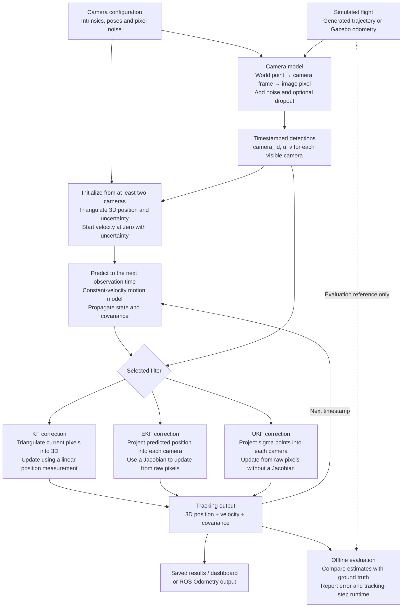
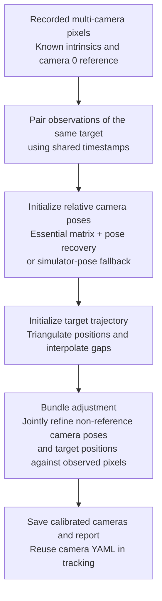

# BEFR Visual Tracking

Multi-camera visual tracking for a simulated quadcopter (Task 1 + advanced camera calibration).

**Authors:** Ece Akdeniz, Lars Wolfgramm-Kuntz  
**Course:** Bayesian Estimation for Flight Robotics (SoSe 2026)  
**Repository:** [github.com/ece-akdeniz/BEFR-Visual-Tracking](https://github.com/ece-akdeniz/BEFR-Visual-Tracking)

## What the project estimates

The tracker estimates **where a simulated drone is and how fast it is moving**, using noisy detections from several cameras.

- **Input:** camera intrinsics and poses, timestamped pixel detections `(camera_id, u, v)`, and filter/noise settings.
- **Output:** the six-value state `[px, py, pz, vx, vy, vz]` and its `6 × 6` covariance. Position is in meters and velocity in meters per second.
- **Scope:** this tracks a point target's position and velocity. It does not estimate object orientation or run an image detector on RGB images. Pixel detections are generated by the camera model.

### The complete tracking pipeline



**Ground truth generates the simulated measurements and supplies the evaluation reference; it is not passed into the base filter as a position measurement.** The KF's position measurement is reconstructed from pixels.

### KF, EKF and UKF: what changes?

All three maintain an estimate and uncertainty, **predict** with the same constant-velocity model, and **correct** using camera evidence. The difference is how they handle the measurement relationship:

- **KF — linear measurement:** first triangulate the pixels into a 3D position. The filter then receives that position and its estimated covariance. Its measurement model simply selects position from the state: `H = [I₃ | 0]`.
- **EKF — local linear approximation:** use the pixels directly. Project the predicted position into a camera and calculate a Jacobian, which describes how a small state change changes the predicted pixel. Correct using the observed-minus-predicted pixel error.
- **UKF — sigma-point approximation:** also use pixels directly, but project a set of carefully chosen states around the estimate through the camera model. Combine their projected values to approximate the measurement mean and covariance. No projection Jacobian is required.

For six state variables, the UKF uses **13 sigma points**. The EKF and UKF still use triangulation for initialization. Their camera corrections are sequential; the matrices below describe one camera update, not a stack of all cameras.

### Important dimensions

- **Shared state/prediction:** state `x`: `6 × 1`; covariance `P`, transition `F` and process-noise covariance `Q`: `6 × 6`.
- **Camera geometry:** position, camera center and translation: `3 × 1`; rotation and camera intrinsic matrix: `3 × 3`; homogeneous transform: `4 × 4`.
- **EKF per camera:** pixel observation and residual: `2 × 1`; projection Jacobian: `2 × 3`; full measurement Jacobian `H`: `2 × 6`; measurement-noise covariance and innovation covariance: `2 × 2`; Kalman gain: `6 × 2`.
- **Triangulation:** ray origin/direction and reconstructed position: `3 × 1`; system matrix `A` and position covariance: `3 × 3`; right-hand side `b`: `3 × 1`.
- **KF position correction:** measurement: `3 × 1`; `H`: `3 × 6`; measurement/innovation covariance: `3 × 3`; Kalman gain: `6 × 3`.

The camera intrinsic matrix and Kalman gain are sometimes both called `K`, but they are different quantities. Likewise, camera rotation and measurement-noise covariance may both be written `R`.

### How the code connects

Follow one observation through these files:

1. [`config/cameras.yaml`](config/cameras.yaml): supplies the camera layout, intrinsics and noise settings.
2. [`camera_model.py`](befr_visual_tracking/camera_model.py): transforms and projects a 3D point, generates noisy pixels, and converts pixels into viewing rays.
3. [`triangulation.py`](befr_visual_tracking/triangulation.py): combines rays into a 3D position and estimates its uncertainty.
4. [`motion_model.py`](befr_visual_tracking/motion_model.py): predicts position, velocity and covariance over elapsed time.
5. [`ekf_tracker.py`](befr_visual_tracking/ekf_tracker.py), [`kalman_tracker.py`](befr_visual_tracking/kalman_tracker.py) or [`ukf_tracker.py`](befr_visual_tracking/ukf_tracker.py): initializes and corrects the estimate.
6. [`experiments/replay.py`](befr_visual_tracking/experiments/replay.py): feeds saved detections into the selected tracker; [`experiments/metrics.py`](befr_visual_tracking/experiments/metrics.py) calculates errors and runtime summaries.

For ROS, [`camera_simulator_node.py`](befr_visual_tracking/camera_simulator_node.py) publishes pixel detections, and [`tracker_node.py`](befr_visual_tracking/tracker_node.py) groups them, calls the same numerical tracker and publishes its output. These continuous streams use publishers/subscribers. The current wrapper groups exact timestamps and skips batches with fewer than two detections; this is more restrictive than the initialized raw-pixel EKF itself.

### Advanced pipeline: calibrating the cameras

This extension estimates the other camera poses and the target trajectory **relative to camera 0**, while keeping intrinsics known. It is a batch calibration step, separate from the online filter corrections.



The optimization minimizes pixel reprojection residuals with a robust loss and optional trajectory smoothness. Fixing camera 0 removes global translation and rotation freedom, **but not scale ambiguity**. A known distance is needed to establish metric scale.

The implementation includes both OpenCV initialization and a simulator-informed fallback. The controlled calibration experiment runner currently disables OpenCV initialization and uses simulator-derived scale for initialization. These runs therefore do not demonstrate vision-only recovery of unknown camera poses. Scale is not explicitly constrained during bundle adjustment; interpret saved evaluation results with the frame and metric caveats in mind.

## Contents

| Path | Description |
|------|-------------|
| `befr_visual_tracking/` | Core package: camera model, triangulation, KF/EKF/UKF, calibration |
| `dashboard/` | Streamlit app for offline experiments and plots |
| `results/` | Saved experiments and calibration datasets |
| `presentation/` | Slides (`presentation.pptx`) and figure exports |
| `launch/` | ROS 2 launch files |
| `tests/` | Unit tests |

## Setup

```bash
python3 -m venv .venv
source .venv/bin/activate
pip install -r requirements.txt
pip install -e .
```

## Dashboard

```bash
source .venv/bin/activate
PYTHONPATH=. streamlit run dashboard/streamlit_app.py
```

Open **http://localhost:8501** in a browser.

- **Interactive tracker**: load saved runs from `results/experiment_NNN/` or rerun filters offline
- **3D visualisation / Time plots**: trajectory and error over time
- **Filter comparison**: KF vs EKF vs UKF (e.g. `experiment_005`, `006`, `007`)
- **Advanced calibration**: bundle adjustment on calibration manoeuvres

## Offline experiments

```bash
PYTHONPATH=. python -m befr_visual_tracking.run_experiments --experiment 1
PYTHONPATH=. python -m befr_visual_tracking.run_calibration results/calibration_figure_eight_3d
```

See `OFFLINE_RESULTS.md` for a short summary of experiment runs.

## Presentation figures

| Location | Figures |
|----------|---------|
| `presentation/plots/advanced/` | Advanced task 3D frames (unknown poses, BA, …) |
| `presentation/plots/observability/` | Exp 101 manoeuvre comparison |
| `befr_visual_tracking/notebooks/final_vis_figures/three_camera_takeoff_circles4/` | Task 1 filter visualisations (Plotly HTML) |
| `befr_visual_tracking/notebooks/final_vis_figures/calibration_figure_eight_3d/` | Calibration task visualisations |
| `befr_visual_tracking/notebooks/final_vis_figures/calibration_figure_eight_3d_advanced/` | Advanced calibration figures |

Regenerate Plotly figures:

```bash
python befr_visual_tracking/notebooks/run_final_vis.py \
  --results-dir results/three_camera_takeoff_circles4

python befr_visual_tracking/notebooks/generate_advanced_lars_figures.py
python befr_visual_tracking/notebooks/generate_observability_manoeuvres_figure.py
```

Notebook source: `befr_visual_tracking/notebooks/final_vis.ipynb`

## ROS 2

```bash
colcon build --packages-select befr_visual_tracking
source install/setup.bash
ros2 launch befr_visual_tracking tracking.launch.py
```

Camera and tracking configs are generated per dataset under `results/*/camera_config.yaml`.
